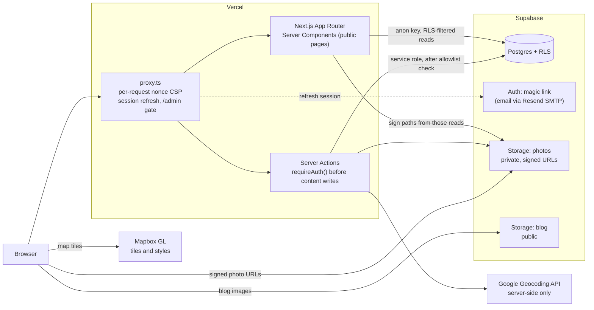

# Sips

A Seattle cafe journal written by two people, with drink-by-drink ratings, visit notes and a map.
Live at **[oursips.com](https://oursips.com)**.

[](https://github.com/vidhartbhatia/sips/actions/workflows/ci.yml)


| Home | Cafe page | Map |
|---|---|---|
| [](https://oursips.com) | [](https://oursips.com/cafes/elm-coffee-roasters) | [](https://oursips.com/map) |

## Features

- **Cafe pages:** an overall rating, vibe tags, a "what we tried" list with a rating and note
  per drink or pastry, and dated visit notes.
- **Map:** every published cafe on a Mapbox map, with search and filters for neighborhood and
  minimum rating.
- **Want to go:** a list of cafes we haven't reviewed yet.
- **Blog:** MDX posts in `content/blog/`.
- **Admin** (two authors only): add cafes (addresses geocoded server-side), write reviews as
  drafts and publish them, upload photos, and bulk-import saved places and lists from a Google
  Takeout export.

## Architecture



Public pages are Server Components that read with the anon key, so Postgres row-level security
decides what a visitor can see. Writes go through Server Actions, which check the session and
the email allowlist, then use the service-role client. RLS also guards the direct API path: the
anon key is public, so every write policy requires an `admin` role in `profiles`, which is only
ever set by hand.

## Engineering notes

- **Per-request nonce CSP, so every route renders dynamically.**
  [`proxy.ts`](proxy.ts) builds a CSP with a fresh nonce and `'strict-dynamic'` for scripts on
  each request. Next.js only stamps that nonce onto its scripts when a page renders per request,
  so the root layout calls `connection()` to opt every route out of static prerendering
  ([`app/layout.tsx`](app/layout.tsx)). Otherwise the browser would block hydration on static
  pages. The trade-off is no static HTML caching. Styles still allow `'unsafe-inline'`, because
  Tailwind and Next.js inject inline `<style>` blocks.
- **Drafts stay private all the way down.** Reviews can be drafts, but their drink notes and
  photos were saved right away and were publicly readable. Migrations
  [005](supabase/migrations/005_items_photos_follow_review_status.sql) and
  [006](supabase/migrations/006_storage_no_list_reviews_need_published_cafe.sql) make `items`,
  `photos` and `reviews` readable only when the parent review *and* its cafe are published,
  failing closed for orphaned rows. They also stop anonymous listing of the Storage bucket.
- **Private photos with cache-friendly signed URLs.**
  [Migration 007](supabase/migrations/007_private_photos_public_blog_bucket.sql) made the photos
  bucket private, because a public bucket serves any object to anyone holding its URL, drafts
  included. The database stores object paths. Public queries
  ([`lib/supabase/queries.ts`](lib/supabase/queries.ts)) keep only photos of published reviews
  and cafes, then pass those paths to the service-role signer in
  [`lib/storage.ts`](lib/storage.ts). Public signed URLs are reused for a whole day, so
  `next/image` sees a stable `src` and its optimizer cache keeps hitting, and each one still has
  at least a day left when it's handed out. Admin URLs are signed fresh and expire in an hour.
  Blog images live in a separate public bucket.
- **Two-person write access, checked in several places.** The magic-link form never creates new
  users (`shouldCreateUser: false`), and an `ALLOWED_EMAILS` allowlist is checked in [`proxy.ts`](proxy.ts) for `/admin`, in
  the [auth callback](app/auth/callback/route.ts), and by `requireAuth()`
  ([`lib/auth.ts`](lib/auth.ts)) before every content write in a Server Action, directly or
  through a guarded helper, since a Server Action is a public endpoint whatever the middleware
  says.
  [Migration 004](supabase/migrations/004_profiles_for_bylines.sql) closed a hole where any
  signed-in user could promote their own profile to `admin`.
- **Layered guards for a public repo.** A [pre-commit hook](.githooks/pre-commit) blocks
  non-noreply author emails, env files, files over 1 MB, personal emails and local paths, and runs
  gitleaks when installed. [CI](.github/workflows/ci.yml) runs gitleaks over the full history and
  rejects new commits with non-noreply author emails, so those two checks still hold when the hook
  is skipped. GitHub secret scanning with push protection is the last layer.

## Built with AI agents

Sips is developed with coding agents, so the process is set up for them.

- [`AGENTS.md`](AGENTS.md) is the single spec that Claude Code, Codex and Copilot all read: the
  stack, hard conventions, and a "check with V." list of decisions an agent must not make alone,
  such as schema, auth, infra and framework changes. `CLAUDE.md` imports it and adds only
  Claude-specific setup.
- Project skills live in [`.agents/skills/`](.agents/skills/), shared across agents, for
  repeatable work like publishing a post or iterating on a design with a live preview.
- Non-trivial diffs get a cross-model review: Codex reviews what Claude wrote, and its findings
  are verified before anything changes.

## Running locally

Needs Node 22 (what CI uses) and a Supabase project of your own.

```bash
npm install                        # also enables the pre-commit hook
cp .env.local.example .env.local   # fill in your own Supabase and Mapbox values
npm run dev                        # http://localhost:3000
```

Apply the schema in [`supabase/migrations/`](supabase/migrations/) in order. Checks:
`npm run typecheck`, `npm run lint`, `npm run build`. CI runs all three on every PR.

More docs: [`docs/design-system.md`](docs/design-system.md) (the "Ink & Paper" design system),
[`docs/roadmap.md`](docs/roadmap.md), [`docs/gotchas.md`](docs/gotchas.md).

## Contributing

This is a personal project, so it isn't looking for feature PRs. Bug reports and fixes are
welcome.

## License

All rights reserved for now. The code may get an open-source license later. Reviews, posts and
illustrations stay all rights reserved.
